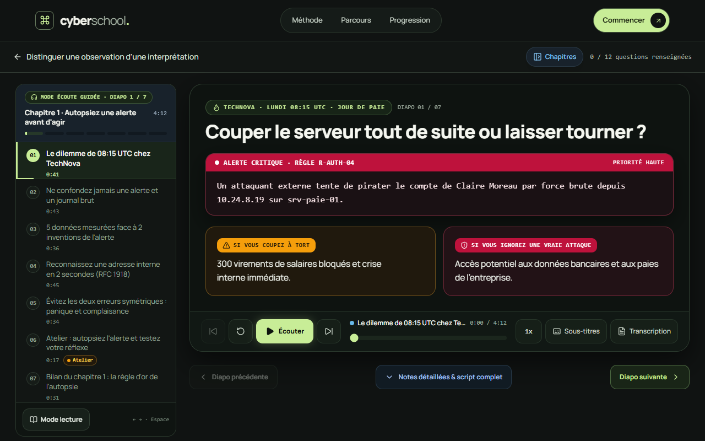
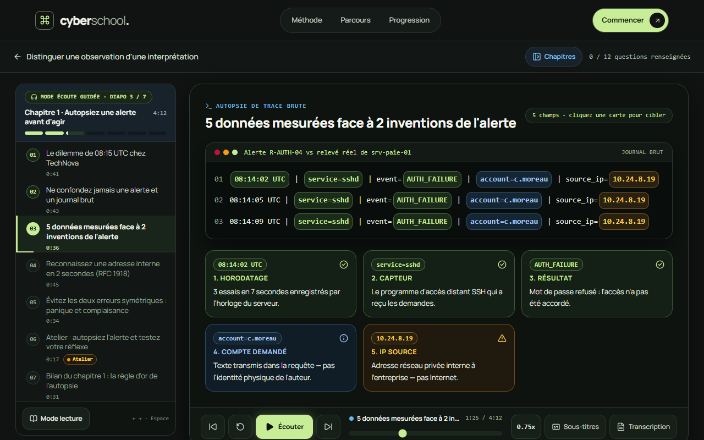
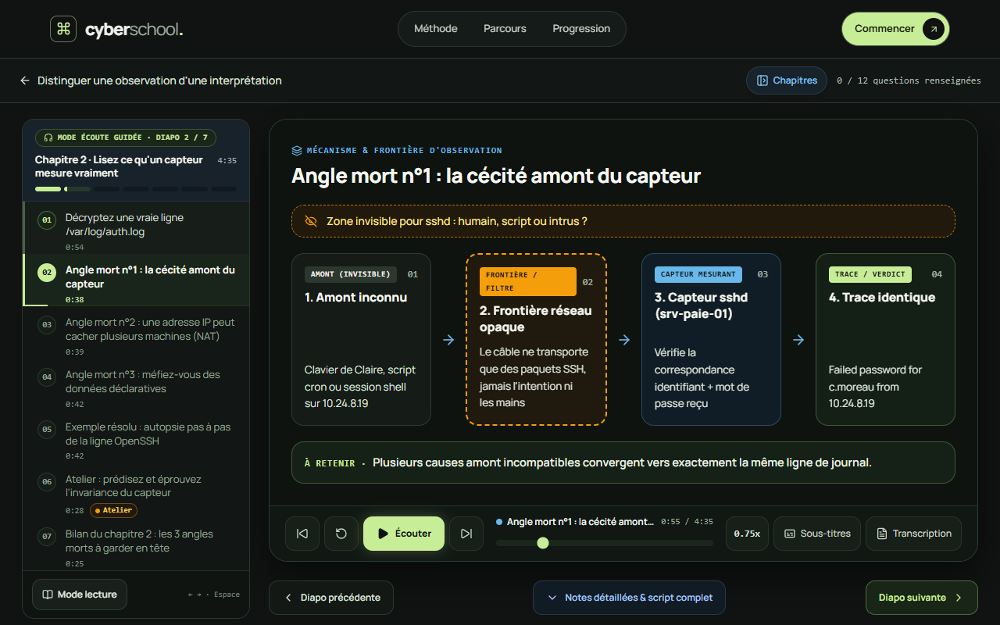
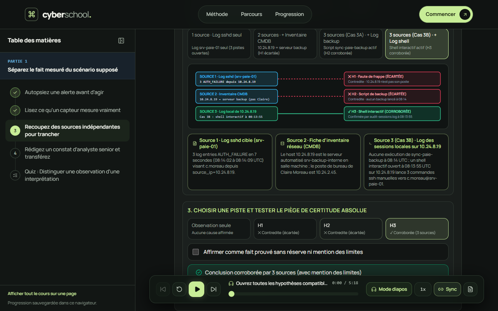
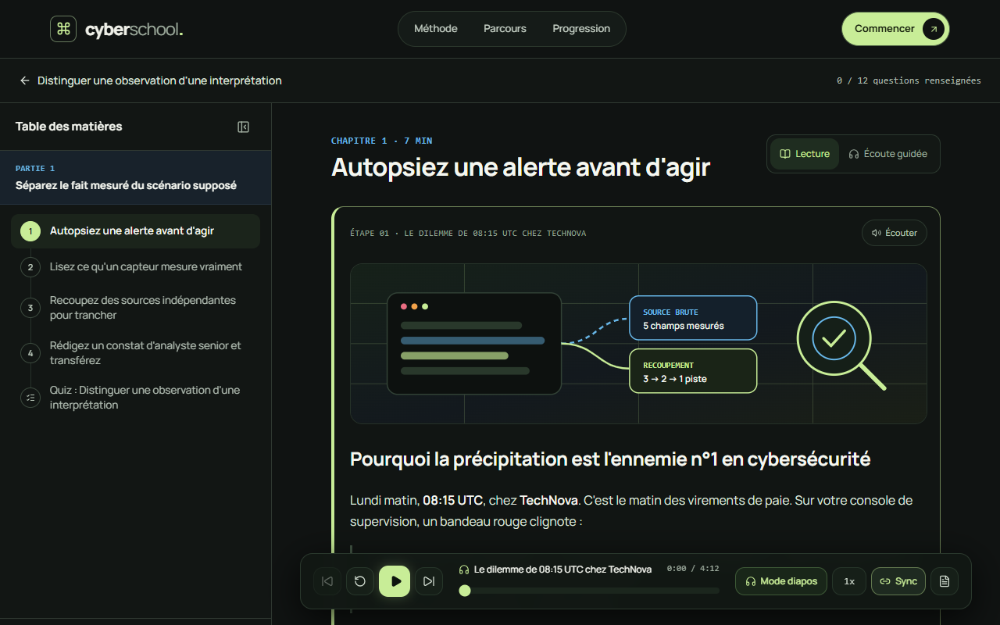
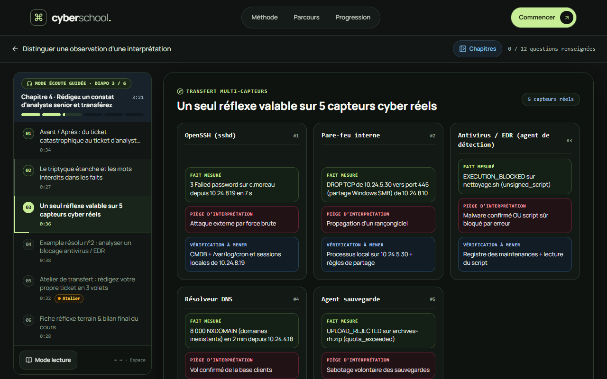
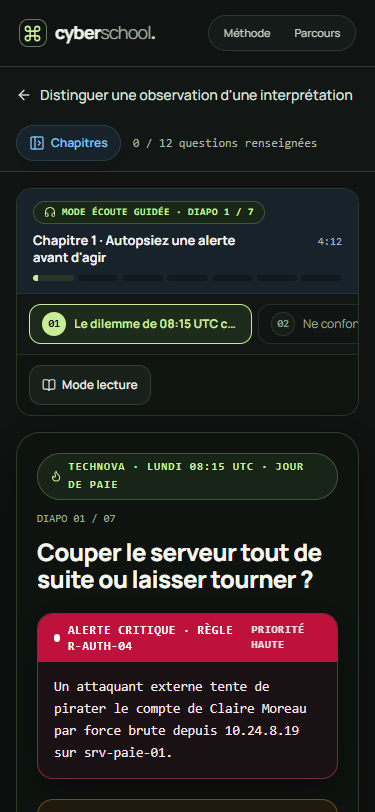
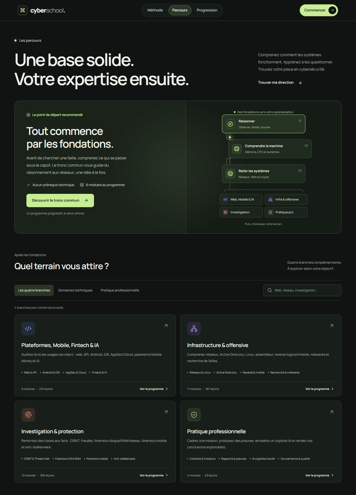
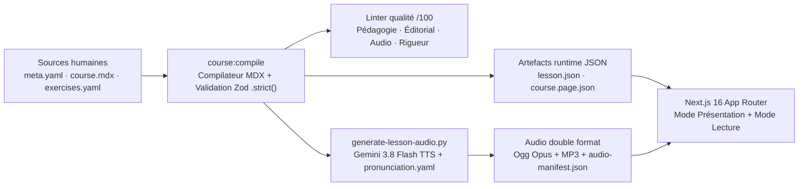

# Cyber School — Plateforme Open Source d'Apprentissage Interactif de la Cybersécurité

[](https://nextjs.org/)
[](https://react.dev/)
[](https://www.typescriptlang.org/)
[](https://tailwindcss.com/)
[](./docs/standards/COURSE_AUTHORING.md)
[](./docs/decisions/ADR-0009-mdx-yaml-bimodal-course-ecosystem.md)
[](./docs/standards/QUALITY_GATES.md)

**Cyber School** est une plateforme web **open source** dédiée à l'apprentissage rigoureux de la **cybersécurité de zéro à l'expertise** (analyse SOC, réseaux, systèmes Linux/Windows, sécurité Web & API, Mobile, IA, Forensics, OSINT et ingénierie offensive).

Contrairement aux cours statiques à rallonge, chaque leçon est rédigée en **MDX + YAML**, compilée et notée sur 100, puis livrée en **deux formats complémentaires** : un **Mode Présentation avec voix off IA synchronisée (« sans lecture »)** inspiré de Keynote/Brilliant, et un **Mode Lecture éditorial** accompagné de **laboratoires 2D déterministes** et d'exercices diagnostiques.

[Aperçu visuel](#aperçu-de-la-plateforme) · [Deux modes d'apprentissage](#deux-modes-dapprentissage-complémentaires) · [Programme V4 (1 122 leçons)](#programme-de-formation-cybersécurité-v4) · [Écosystème MDX & Voix off](#écosystème-open-source-mdx--yaml--gemini-tts) · [Installation](#installation-et-démarrage-local) · [Vérifications](#scripts-de-vérification-et-garde-fous-qualité) · [FAQ](#questions-fréquentes-faq)

---

## Aperçu de la plateforme



> **Mode Présentation / Écoute guidée (« sans lecture »)** : sommaire vertical fixe des diapositives à gauche (durées, progression et badges _Atelier_), scène visuelle expressive à droite, et barre de lecture voix off (**Gemini 3.8 Flash TTS**, double format Ogg Opus + MP3) intégrée sous la diapositive sans aucun chevauchement.

---

## Deux modes d'apprentissage complémentaires

Chaque cours peut être suivi librement selon votre contexte — au calme à l'écrit, ou à l'écran + casque sans avoir à lire de longs paragraphes — tout en conservant votre position exacte et votre vitesse de lecture lors du passage d'un mode à l'autre.

| Fonctionnalité            | Mode Présentation / Écoute guidée (« sans lecture »)                                       | Mode Lecture éditorial                                                                  |
| ------------------------- | ------------------------------------------------------------------------------------------ | --------------------------------------------------------------------------------------- |
| **Usage idéal**           | Apprendre sans lire de pavés de texte, réviser activement, suivre à l'oreille avec visuels | Approfondir un concept à son rythme, annoter, relire une fiche réflexe                  |
| **Mise en scène**         | **28 diapositives expressives** sur 8 gabarits visuels + **sommaire vertical à gauche**    | Manuel structuré chapitre par chapitre + table des matières latérale                    |
| **Voix off synchronisée** | Voix mentor **Gemini 3.8 Flash TTS** avec pauses automatiques sur les ateliers             | Lecteur audio flottant synchronisé bloc par bloc + bouton _Écouter_ par étape           |
| **Sous-titres & script**  | Sous-titres masqués par défaut (_principe de redondance de Mayer_), activables en 1 clic   | Transcription en direct et prose complète directement consultables                      |
| **Pratique intégrée**     | Schémas interactifs, laboratoire 2D déterministe et micro-vérifications sous la diapo      | Mêmes laboratoires interactifs, exemples résolus pas à pas et quiz final (12 questions) |

### Galerie interactive (captures réelles desktop & mobile)

|                                                              Autopsie interactive d'un journal OpenSSH                                                              |                                                          Mécanismes & angles morts d'un capteur                                                          |
| :-----------------------------------------------------------------------------------------------------------------------------------------------------------------: | :------------------------------------------------------------------------------------------------------------------------------------------------------: |
|  |  |
|                       _Surlignage interactif des champs mesurés (`horodatage UTC`, `service=sshd`, `AUTH_FAILURE`, `account`, `source_ip`)._                        |                             _Visualisation de la frontière réseau opaque : plusieurs causes amont produisent la même trace._                             |

|                                                                              Laboratoire 2D déterministe (`ObservationWorkbench`)                                                                               |                                                                    Mode Lecture éditorial & audio synchronisé                                                                    |
| :-------------------------------------------------------------------------------------------------------------------------------------------------------------------------------------------------------------: | :------------------------------------------------------------------------------------------------------------------------------------------------------------------------------: |
|  |  |
|                                            _Simulation déterministe à 3 sources (journal `sshd`, inventaire CMDB, journaux locaux Cas 3A bénin vs Cas 3B hostile)._                                             |                                      _Expérience de lecture apaisée avec table des matières, exemples résolus et barre audio synchronisée._                                      |

|                                                                            Transfert sur 5 capteurs cybersécurité réels                                                                             |                                                     Expérience mobile responsive (jusqu'à `320px`)                                                      |
| :-------------------------------------------------------------------------------------------------------------------------------------------------------------------------------------------------: | :-----------------------------------------------------------------------------------------------------------------------------------------------------: |
|  |  |
|                                          _Une seule méthode transférable sur `sshd`, pare-feu (port 445 SMB), antivirus/EDR, résolveur DNS et sauvegarde._                                          |                       _Mise en page adaptative vérifiée par Playwright sur desktop (`1280×800`), mobile (`375×812`) et `320px`._                        |

---

## Programme de formation cybersécurité V4

Le référentiel V4 de Cyber School cartographie une progression complète **sans prérequis initial**, articulée autour d'un graphe de concepts atomiques (`Domaine -> Module -> Chapitre -> Concept atomique -> Leçon -> Exercices -> Évaluations -> Laboratoires externes`) couvrant **6 programmes, 54 modules, 1 122 micro-leçons, 772 compétences et 9 examens**.



| Programme / Branche                               | Contenu principal                                                                                                                                              | Volume V4               |
| ------------------------------------------------- | -------------------------------------------------------------------------------------------------------------------------------------------------------------- | ----------------------- |
| **Tronc commun & Fondations** _(point de départ)_ | Logique, preuve et recherche, représentation binaire & mémoire, Linux/Windows, réseaux de l'électricité à HTTP, Web/API, algorithmique & IA, crypto & identité | 8 modules · 208 leçons  |
| **Plateformes, Mobile, Fintech & IA**             | Audit Web & API, sécurité Android & iOS, AppSec & Cloud, paiements Mobile Money, sécurité des systèmes IA                                                      | 9 modules · 210 leçons  |
| **Infrastructure & Offensive**                    | Réseaux & Linux avancés, Active Directory, assembleur, reverse engineering logiciel/mobile, recherche de vulnérabilités & malwares                             | 11 modules · 287 leçons |
| **Investigation & Protection**                    | OSINT & Threat Intelligence, détection de fraudes, forensics disque/RAM/réseau, forensics mobile & anti-stalkerware                                            | 12 modules · 206 leçons |
| **Pratique professionnelle**                      | Cadrage de mission & contrats, rédaction de preuves & rapports d'audit, copilote IA encadré, gouvernance & qualité                                             | 4 modules · 63 leçons   |
| **Compléments transversaux**                      | Modules optionnels d'approfondissement (cloud-native, identités modernes, preuves synthétiques IA, méthodologies d'audit)                                      | 10 modules · 148 leçons |

> **Statut actuel du contenu** : le catalogue V4 complet est consultable et navigable sur `/parcours`. Le cours pilote **« Distinguer une observation d'une interprétation »** (`/cours/observation-et-interpretation`) est complet (4 chapitres, 28 diapositives, ~19 min de voix off Gemini, laboratoire 2D déterministe, 12 questions de quiz) et reste volontairement en statut `in-review` en attente de validation humaine finale conformément aux [garde-fous qualité](./docs/standards/QUALITY_GATES.md).

---

## Écosystème Open Source MDX + YAML + Gemini TTS

La méthodologie d'écriture et de production est entièrement ouverte, reproductible et conçue pour industrialiser l'ensemble du programme V4 sans bricolage manuel. Voir l'[ADR-0009](./docs/decisions/ADR-0009-mdx-yaml-bimodal-course-ecosystem.md) et le guide [COURSE_AUTHORING.md](./docs/standards/COURSE_AUTHORING.md).



### Principes pédagogiques embarqués dans le compilateur

- **Zéro jargon non défini** : chaque acronyme technique (`log`, `UTC`, `sshd`, `RFC 1918`, `NAT`, `CMDB`, `NTP`, `PTR`, `SIEM`, `EDR`) est expliqué simplement dès sa première apparition.
- **Sources primaires vérifiées** : chaque leçon s'appuie sur des standards officiels datés (ex. _NIST SP 800-92_, _NIST SP 800-61r3_, _IETF RFC 1918_, _NGSS Appendix F_).
- **Rédaction orale naturelle dédiée** : chaque `<Scene>` sépare le texte lu (`prose`/`<Slide>`) du script parlé (`<AudioScript>`), filtré par un dictionnaire de prononciation partagé ([curriculum/pronunciation.yaml](./curriculum/pronunciation.yaml)) et synthétisé via **Gemini 3.8 Flash TTS** (`google-genai`).
- **Linter automatique bloquant** : rejette les tons pompeux, les fuites d'identifiants internes, les distracteurs caricaturaux ou les `<MicroCheck>` mal câblés.

---

## Installation et démarrage local

### Prérequis

- **Node.js LTS** `^22.12.0 || ^24.0.0 || ^26.0.0` (Node `23` est refusé par le diagnostic pré-vol ; CI sur Node `22`).
- **pnpm** `10.28.0` via **Corepack** (`packageManager` épinglé dans [package.json](./package.json)).
- **Git**.
- _(Optionnel — uniquement pour régénérer les voix off)_ **Python 3.12+**, [`uv`](https://docs.astral.sh/uv/), **`ffmpeg`** et une clé `GEMINI_API_KEY` dans `.env.local` (jamais commitée).

> Si `pnpm` n'est pas installé globalement dans votre `PATH`, préfixez toutes les commandes par **`corepack pnpm`**.

### 1. Installer les dépendances

```bash
corepack pnpm install --frozen-lockfile
```

> `corepack pnpm quality:environment` diagnostique les éventuels blocages d'environnement sans modifier votre système.

### 2. Lancer l'application en développement

```bash
corepack pnpm dev
```

`corepack pnpm dev` démarre en parallèle l'application Next.js (`apps/web`) et le mode watch (`tsc --watch`) des packages internes (`@cyber-school/lesson-runtime`, `@cyber-school/ui`, `@cyber-school/animations`, `@cyber-school/exercises`).

Ouvrez ensuite dans votre navigateur :

- **Accueil de la plateforme** : `http://localhost:3000/`
- **Carte des parcours V4** : `http://localhost:3000/parcours`
- **Tronc commun & Fondations** : `http://localhost:3000/parcours/v4-tronc-commun`
- **Cours pilote complet (Mode Présentation 28 diapos + Mode Lecture + Voix off)** : `http://localhost:3000/cours/observation-et-interpretation`

### 3. Compiler un cours MDX + YAML et synthétiser la voix off

```bash
# Compiler et évaluer le score qualité (/100) d'une leçon MDX + YAML
corepack pnpm course:compile -- --slug observation-et-interpretation

# Auditer le score qualité seul (sans réécrire les JSON compilés)
corepack pnpm course:lint -- --slug observation-et-interpretation

# Régénérer les pistes audio Ogg Opus + MP3 via Gemini 3.8 Flash TTS (nécessite GEMINI_API_KEY dans .env.local)
uv run --with "google-genai>=3.2.0" python scripts/media/generate-lesson-audio.py --slug observation-et-interpretation --workers 3
```

---

## Scripts de vérification et garde-fous qualité

Les [garde-fous de qualité](./docs/standards/QUALITY_GATES.md) exigent des preuves exécutables réelles avant toute clôture de tâche ou publication de leçon.

| Commande                                                              | Rôle                                                                                                                           |
| --------------------------------------------------------------------- | ------------------------------------------------------------------------------------------------------------------------------ |
| `corepack pnpm typecheck`                                             | Vérification TypeScript stricte (`apps/web`, packages workspace, `playwright.config.ts`, `tests/` et `scripts/`)               |
| `corepack pnpm lint`                                                  | Analyse statique ESLint (incluant `eslint-plugin-react-hooks` React Compiler et règles Next.js App Router)                     |
| `corepack pnpm format:check`                                          | Vérification de formatage Prettier sur tout le dépôt                                                                           |
| `corepack pnpm validate:governance`                                   | Vérifie les liens Markdown locaux, les `@imports`, la parité `.agents/skills` <-> `.claude/skills`, les preuves et `planning/` |
| `corepack pnpm validate:curriculum`                                   | Validation Zod `.strict()` des ressources, concepts, leçons compilées et détection de cycles                                   |
| `corepack pnpm test:unit`                                             | Exécution de la suite de tests unitaires Vitest                                                                                |
| `corepack pnpm build`                                                 | Build de production complet (packages + Next.js)                                                                               |
| `corepack pnpm test:e2e`                                              | Suite navigateur Playwright (`1280×800`, `375×812`, `320px`, `reducedMotion`, clavier, console, géométrie sans chevauchement)  |
| `corepack pnpm test:guards`                                           | Tests natifs des refus : preuves périmées, fausses clôtures, publication non revue                                             |
| `corepack pnpm quality:verify -- --task TASK-026`                     | Chaîne complète des 9 portes qualité avec génération des preuves vérifiables sous `continuity/validation/`                     |
| `corepack pnpm quality:checkpoint -- --task TASK-026 --next "Action"` | Régénère `continuity/CURRENT_STATE.md` et `continuity/HANDOFF.md` depuis l'état réel du dépôt                                  |

> **Note Playwright** : [playwright.config.ts](./playwright.config.ts) réutilise un navigateur Chromium déjà présent localement dans `%LOCALAPPDATA%/ms-playwright` lorsqu'il est compatible (`corepack pnpm exec playwright install chromium` reste utilisable si absent).

---

## Architecture du dépôt

```text
cyber-school/
├── apps/web/                     # Application Next.js 16 (App Router, React 19, Tailwind CSS v4)
│   ├── public/audio/lessons/     # Pistes audio servies en Ogg Opus + MP3 par chapitre
│   └── src/components/course/    # Mode Présentation (28 diapos), Mode Lecture, 4 schémas & ObservationWorkbench
├── packages/
│   ├── lesson-runtime/           # Schémas Zod .strict(), compilateur MDX+YAML, linter qualité et validateur de graphe
│   ├── ui/                       # Design system sombre Cyber School accessible (tokens.css, Button, Card, Badge…)
│   ├── animations/               # Primitives GSAP & Motion respectant prefers-reduced-motion
│   └── exercises/                # Composants d'exercices interactifs accessibles au clavier
├── lessons/                      # Sources MDX + YAML (meta.yaml, course.mdx, exercises.yaml) & artefacts compilés
├── curriculum/                   # Référentiel V4, prononciation TTS (pronunciation.yaml) et graphe de concepts
├── resources/                    # Catalogue des sources scientifiques et standards primaires (NIST, IETF, NGSS…)
├── scripts/
│   ├── curriculum/               # Import V4, compilateur course:compile, générateur de missions & audit
│   ├── media/                    # Synthèse voix off Gemini 3.8 Flash TTS (generate-lesson-audio.py)
│   └── quality/                  # Garde-fous, checkpoints et preuves exécutables
├── tests/e2e/                    # Tests Playwright end-to-end (desktop, mobile, 320px, accessibilité)
├── docs/                         # Vision, architecture, ADR (ADR-0001 à ADR-0009), standards & captures README
└── planning/ & continuity/       # Roadmap, tâches et continuité multi-agents (Codex, Claude Code, Gemini CLI)
```

---

## Gouvernance et compatibilité CLI agents IA

Ce dépôt applique une gouvernance partagée et vérifiée entre **OpenAI Codex**, **Anthropic Claude Code** et **Google Gemini CLI** :

| Outil CLI                 | Entrypoint & Skills                                                                 |
| ------------------------- | ----------------------------------------------------------------------------------- |
| **OpenAI Codex**          | [AGENTS.md](./AGENTS.md) · `.agents/skills/` · `.codex/agents/`                     |
| **Anthropic Claude Code** | [CLAUDE.md](./CLAUDE.md) · `.claude/skills/` _(miroir vérifié)_ · `.claude/agents/` |
| **Google Gemini CLI**     | [GEMINI.md](./GEMINI.md) · `.agents/skills/` · `.gemini/agents/`                    |

Tout contributeur ou agent entrant commence par [continuity/RESUME_PROTOCOL.md](./continuity/RESUME_PROTOCOL.md), puis consulte [docs/agents/AGENT_GUIDE.md](./docs/agents/AGENT_GUIDE.md), [continuity/CURRENT_STATE.md](./continuity/CURRENT_STATE.md) et [continuity/HANDOFF.md](./continuity/HANDOFF.md).

---

## Questions fréquentes (FAQ)

### Peut-on apprendre la cybersécurité sur Cyber School sans prérequis technique ?

Oui. Le **Tronc commun** commence par la méthode d'analyse scientifique (séparer un fait mesuré d'une hypothèse dans un journal système) avant d'aborder la mémoire, les systèmes Linux/Windows, les réseaux et la sécurité offensive ou défensive. Chaque terme technique est défini dès sa première apparition.

### Comment fonctionne le mode « sans lecture » avec voix off ?

En cliquant sur **« Écouter le cours en diapos (sans lecture) »**, l'interface bascule sur un studio de présentation avec un sommaire vertical des diapositives à gauche et des scènes visuelles expressives à droite. La voix mentor générée par **Gemini 3.8 Flash TTS** guide la compréhension diapositive par diapositive et marque automatiquement une pause sur chaque atelier interactif. Les sous-titres et les notes écrites restent accessibles à la demande en un clic.

### Comment contribuer à une nouvelle leçon open source ?

Consultez [docs/standards/COURSE_AUTHORING.md](./docs/standards/COURSE_AUTHORING.md) et [docs/curriculum/COMPLETE_COURSE_WORKFLOW.md](./docs/curriculum/COMPLETE_COURSE_WORKFLOW.md) : rédigez `meta.yaml`, `course.mdx` et `exercises.yaml`, vérifiez le score qualité avec `corepack pnpm course:compile -- --slug <slug>`, générez l'audio si nécessaire puis exécutez la chaîne complète `corepack pnpm quality:verify -- --task <TASK-ID>`.

### Quels standards encadrent la rigueur scientifique des cours ?

Les cours citent exclusivement des spécifications et publications primaires datées — par exemple **NIST SP 800-92** (_Guide to Computer Security Log Management_), **NIST SP 800-61r3** (_Incident Response Recommendations_), **IETF RFC 1918** et **NGSS Appendix F** — et explicitent systématiquement les limites pédagogiques de chaque simulateur.
