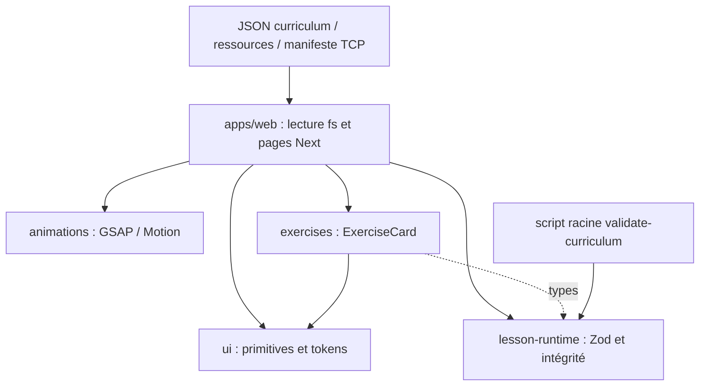

# Audit architectural et technique

## Vision reconstituée

Les documents de vision, exigences, ADR et standards décrivent un corpus de cours conçus et revus, organisé autour de concepts atomiques réutilisables. L'application sert de catalogue et de shell à des expériences de compréhension : animations, diagrammes, simulations, exercices et laboratoires externes. Un assistant contextuel est envisagé plus tard. Le corpus ne doit pas être généré à la demande de chaque apprenant.

M1 exige un socle testable et reprenable, puis une leçon TCP accessible. M2 prévoit graphes, extension réseaux et progression persistante ; M3 active la 3D sous justification pédagogique. Il n'existe pas d'exigence initiale précise sur authentification, hébergement, données personnelles, administration éditoriale, volumétrie de trafic, budget de bundle 2D ou objectif de disponibilité. Ces choix ne sont pas inventés comme obligations de M1. Une procédure de publication/revue devient en revanche nécessaire pour donner un sens au statut published actuel.

## Topologie effectivement présente

Le graphe des packages est simple, sans cycle manifeste ni package vide. Le runtime n'importe ni React, ni UI, ni animation. Exercises consomme les types du runtime et les primitives UI. Les imports internes des packages utilisent les chemins `.js` adaptés aux sorties ESM ; `workspace:*` déclare les liens de l'application et des exercices. Les exports publics sont explicites. Les dépendances React sont peers et dépendances de développement des bibliothèques : ce doublon a une utilité de test et ne constitue pas une duplication de responsabilité.

| Unité | Responsabilité réelle | Limite |
| --- | --- | --- |
| `apps/web` | Deux routes, lecture de trois JSON, catalogue et composant TCP d'environ 750 lignes | Simulation, texte et orchestration d'une leçon encore dans le shell |
| `lesson-runtime` | Schémas et DFS de prérequis, diagnostics | Pas de contrôleur de leçon générique ni d'intégrité complète des exercices |
| `ui` | Button, Card, Badge, Alert, Progress, Separator, tokens et utilitaire de classes | Primitives simples ; « compatible shadcn » ne prouve pas un système complet d'accessibilité |
| `animations` | Scope GSAP, préférence de mouvement et panneau Motion | Aucune timeline partagée pause/reprise |
| `exercises` | Trois variantes via une carte React | Scoring local et éphémère ; pas de moteur cumulatif |
| Données racine | Quatre concepts, un domaine, deux modules, deux chapitres, une leçon et trois ressources | Un seul catalogue chargé ; pas de registre général des leçons |

## Évaluation des choix

**Next.js / React.** L'App Router permet un catalogue et des sources rendus côté serveur, avec une frontière client sur le simulateur et les exercices. `fs` reste dans le chargeur serveur ; aucun accès navigateur à `fs` relevé. Le rendu de la leçon transmet son manifeste au client, y compris bonnes réponses : cela convient à l'autoévaluation pédagogique actuelle, mais n'apporte aucune intégrité pour une future certification à enjeu. Les peerDependencies npm consultées de Next 16.4.6 et React DOM 19.3.1 sont compatibles avec les déclarations React 19.3.1 ; le build reste non exécuté.

**TypeScript / Zod.** `strict`, `noUncheckedIndexedAccess`, imports de types et exports ESM constituent une base adaptée. `skipLibCheck` réduit la vérification des déclarations tierces ; ce n'est pas en soi un défaut du socle. Les packages compilent par `tsc`, et `typecheck`/tests attendent `^build`. Le champ `declaration` est utile aux bibliothèques. Les tests et les configurations/scripts racine ne bénéficient pas du même périmètre de typage. Zod assure des formes, mais les références requièrent le validateur séparé (AUD-008/009/018/032).

**Tailwind v4.** Tokens CSS et variantes CVA sont une approche légère. Les trois chemins `@source` sont faux (AUD-007). Selon la documentation officielle, ces chemins sont relatifs à la feuille CSS ; l'observation du CSS compilé reste à faire. [Détection des sources Tailwind](https://tailwindcss.com/docs/detecting-classes-in-source-files).

**GSAP / Motion.** Les rôles sont distincts : GSAP déplace le paquet SVG, Motion anime le panneau explicatif. Les deux sont réellement utilisés dans le monorepo. Une unification prématurée n'est pas justifiée ; il faut d'abord corriger synchronisation et préférence de mouvement. La dépendance Motion directe dans web et le plugin React Vite non configuré sont des candidats à examen, pas des suppressions exécutées (AUD-030).

**Three.js, React Three Fiber, Drei, D3, XYFlow.** Aucun de ces packages n'est déclaré ou importé dans le socle actuel. Ils sont documentés comme futurs, sans faux package placeholder. Leur absence est cohérente avec la leçon TCP 2D. Le support réel du GPU, des graphes et des scènes 3D n'est pas démontré par les seuls standards écrits. Il faudra réévaluer versions, SSR et budgets au moment de l'activation.

**pnpm / Turborepo.** Six projets workspace, quatre bibliothèques compilées, orchestration et cache sont proportionnés au projet. pnpm 10.28.0 est disponible via Corepack, mais l'absence de lockfile bloque la CI. `dev` ne prépare pas les exports `dist/`, et les données JSON lues à l'extérieur des packages ne sont pas modélisées dans le cache (AUD-001/005/006). Les mécanismes officiels `globalDependencies` et `$TURBO_ROOT$` permettent d'expliciter ces entrées ; leur comportement doit être confirmé sur la version retenue. [Configuration Turborepo](https://turborepo.dev/docs/reference/configuration).

## Maintenabilité et passage à l'échelle

La hiérarchie Domain/Module/Chapter avec références vers une liste de concepts permet déjà la réutilisation : le concept handshake apparaît dans deux chapitres sans duplication de sa définition. Le DFS est globalement linéaire en sommets/arêtes pour la détection de cycles ; aucune mesure à grande taille n'a été faite. La récursion profonde et les diagnostics sur un corpus massif sont des points à éprouver, pas des pannes observées.

Le coût principal à grande échelle serait éditorial et structurel : chemins fixes du chargeur, un seul curriculum validé, logique spécifique dans le shell et explications dupliquées entre JSON et TSX. Les recherches `.find()` répétées suffisent pour quatre concepts ; un index serait justifié par la croissance mesurée plutôt que par une optimisation immédiate. Un registre, des identifiants d'étapes communs et une frontière entre modèle scientifique, scénario et vue doivent être éprouvés avec un deuxième cours avant des milliers d'entrées (AUD-019).

La lecture `fs` cherche la racine dans trois répertoires parents et lit des données hors de l'application. Cela fonctionne conceptuellement depuis la racine ou `apps/web`, mais aucun artefact de déploiement n'a été testé. Un packaging standalone ou pruné devra emporter explicitement le corpus ; il serait prématuré d'affirmer son fonctionnement ou son échec actuel.

## Décision d'architecture proposée

Conserver les quatre frontières actuelles et la priorité 2D. Valider d'abord dépendances, développement, cache et contrats. Aucun besoin démontré de nouvelle base de données, orchestrateur, microservice, package 3D ou nouvelle bibliothèque pour sortir M1. Toute évolution structurante du registre ou des contrats devra faire l'objet d'un ADR proposé et d'une validation humaine, conformément au guide. Le registre détaillé des corrections est AUD-001 à AUD-009, AUD-017 à AUD-019 et AUD-027 à AUD-032.
