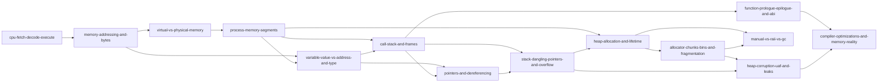

# Décomposition atomique des concepts — Mémoire d'un programme

Les 14 concepts ci-dessous correspondent 1-pour-1 aux entrées validées dans [curriculum/program-memory-foundations.json](../../../curriculum/program-memory-foundations.json). Aucun cycle n'existe dans le graphe de prérequis.

## 1. Graphe de dépendances (DAG)

---

## 2. Fiches détaillées des 14 concepts atomiques

### `cpu-fetch-decode-execute` — Cycle Fetch-Decode-Execute et pointeur d'instruction

- **Identifiant** : `cpu-fetch-decode-execute`
- **Nom** : Cycle Fetch-Decode-Execute et pointeur d'instruction
- **Définition technique** : Boucle matérielle par laquelle le processeur lit l'instruction pointée par le registre `PC`/`RIP` en mémoire, la décode, l'exécute sur ses registres ou la RAM, puis met à jour `PC`/`RIP` (incrément séquentiel ou nouvelle cible de saut).
- **Prérequis** : aucun (point d'entrée).
- **Objectifs d'apprentissage** :
  - Décrire le rôle de `PC`/`RIP`, du registre d'instruction (`IR`) et des registres généraux pendant une instruction.
  - Expliquer pourquoi le code exécutable et les données résident tous deux en mémoire adressable (architecture von Neumann).
- **Difficulté conceptuelle** : `foundational` — exige de dissocier l'« action » du code source de la lecture passive d'octets d'instructions à une adresse donnée.
- **Erreurs de compréhension fréquentes** :
  - Croire que le CPU « lit » le fichier source texte ligne par ligne.
  - Penser que les instructions ne sont pas en mémoire ou que `RIP` pointe vers la donnée manipulée plutôt que vers l'instruction courante.
- **Relations avec les autres concepts** : point d'appui de `memory-addressing-and-bytes` (`builds_on`).
- **Critères de maîtrise** : ordonner Fetch, Decode, Execute et Update `PC` pour un chargement mémoire et pour un saut conditionnel ; prédire la nouvelle valeur de `RIP`.

---

### `memory-addressing-and-bytes` — Adressage par octet, taille de type et endianness

- **Identifiant** : `memory-addressing-and-bytes`
- **Nom** : Adressage par octet, taille de type et endianness
- **Définition technique** : Organisation linéaire de la mémoire où chaque octet possède une adresse unique et où les valeurs multi-octets occupent des adresses contiguës selon un ordre des octets (_little-endian_ ou _big-endian_).
- **Prérequis** : `cpu-fetch-decode-execute`.
- **Objectifs d'apprentissage** :
  - Calculer l'intervalle d'adresses occupé par une donnée de 1, 4 ou 8 octets à partir de son adresse de base.
  - Interpréter l'ordre des octets en mémoire en représentation _little-endian_ sur x86-64.
- **Difficulté conceptuelle** : `foundational` — la confusion entre taille logique d'un nombre et occupation physique de plusieurs cases mémoire est très fréquente.
- **Erreurs de compréhension fréquentes** :
  - Supposer qu'un `int32` occupe une seule adresse unique au lieu de 4 adresses consécutives.
  - Inverser les digits hexadécimaux à l'intérieur d'un même octet en _little-endian_ (ex. transformer `0x12` en `0x21` au lieu de préserver chaque octet intact tout en inversant l'ordre des octets).
- **Relations avec les autres concepts** : `builds_on` `cpu-fetch-decode-execute` ; `applied_in` depuis `variable-value-vs-address-and-type`.
- **Critères de maîtrise** : déterminer les 4 octets exacts aux adresses `A..A+3` pour un entier 32 bits en _little-endian_.

---

### `virtual-vs-physical-memory` — Mémoire virtuelle, pagination et MMU

- **Identifiant** : `virtual-vs-physical-memory`
- **Nom** : Mémoire virtuelle, pagination et MMU
- **Définition technique** : Abstraction fournie par le système d'exploitation et la MMU (_Memory Management Unit_) qui donne à chaque processus un espace d'adressage virtuel contigu et isolé, traduit par pages (typiquement 4 Kio) vers des cadres de pages physiques discontinus.
- **Prérequis** : `memory-addressing-and-bytes`.
- **Objectifs d'apprentissage** :
  - Expliquer pourquoi deux processus peuvent posséder exactement la même adresse virtuelle (`0x401000`) sans s'écraser mutuellement.
  - Identifier le rôle de la table des pages, du défaut de page (_page fault_) légitime et de l'erreur de segmentation (`SIGSEGV`).
- **Difficulté conceptuelle** : `intermediate` — demande de renoncer à l'idée naïve que `0x401000` désigne directement un emplacement sur une barrette RAM.
- **Erreurs de compréhension fréquentes** :
  - Croire qu'une adresse affichée par un programme ou un débogueur est une adresse physique en RAM.
  - Confondre tout _page fault_ avec un plantage (alors que le _demand paging_ est un mécanisme normal du noyau).
- **Relations avec les autres concepts** : `builds_on` `memory-addressing-and-bytes` ; englobe `process-memory-segments` (`part_of`).
- **Critères de maîtrise** : distinguer sur schéma une traduction MMU valide, une allocation paresseuse légitime et un accès interdit générant `SIGSEGV`.

---

### `process-memory-segments` — Segments de l'espace mémoire d'un processus

- **Identifiant** : `process-memory-segments`
- **Nom** : Segments de l'espace mémoire d'un processus
- **Définition technique** : Découpage logique d'un processus en régions virtuelles aux permissions (`rwxp`) et durées de vie distinctes : `Text` (`r-x`), `Data` initialisée et `BSS` (`rw-`), `Heap` (`rw-`), zones `mmap` et `Stack` (`rw-`).
- **Prérequis** : `virtual-vs-physical-memory`.
- **Objectifs d'apprentissage** :
  - Associer code machine, constante globale, variable globale non initialisée, allocation dynamique et variable locale à leur segment et permissions.
  - Expliquer pourquoi écrire dans `Text` ou exécuter des octets dans `Stack` (sous protection NX/DEP) échoue au niveau matériel.
- **Difficulté conceptuelle** : `foundational` — nécessite de ne pas confondre la _zone d'affichage graphique_ avec des barrières matérielles physiques fixes.
- **Erreurs de compréhension fréquentes** :
  - Croire que la pile et le tas se touchent toujours immédiatement (ou ignorer les zones `mmap` intermédiaires et l'ASLR).
  - Penser que toutes les données du programme sont regroupées au même endroit modifiables librement.
- **Relations avec les autres concepts** : `part_of` `virtual-vs-physical-memory` ; alimente `variable-value-vs-address-and-type` et `call-stack-and-frames`.
- **Critères de maîtrise** : classer 5 artefacts logiciels dans le bon segment et déduire l'issue matérielle d'un accès violant `r`/`w`/`x`.

---

### `variable-value-vs-address-and-type` — Variable : nom symbolique, adresse, type et valeur

- **Identifiant** : `variable-value-vs-address-and-type`
- **Nom** : Variable : nom symbolique, adresse, type et valeur
- **Définition technique** : Correspondance établie à la compilation entre un identifiant lisible dans le code source, une localisation (registre ou adresse/offset mémoire), une taille typée et l'interprétation des bits stockés.
- **Prérequis** : `memory-addressing-and-bytes`, `process-memory-segments`.
- **Objectifs d'apprentissage** :
  - Dissocier le nom symbolique (disparu dans le binaire final sans symboles de débogage), l'adresse, la taille et la valeur.
  - Expliquer pourquoi lire une variable locale non initialisée expose les bits résiduels laissés par un usage antérieur (et constitue un comportement indéfini en C).
- **Difficulté conceptuelle** : `foundational` — les langages haut niveau cachent l'identité de l'emplacement derrière le nom.
- **Erreurs de compréhension fréquentes** :
  - Penser qu'affecter `b = a` lie désormais `a` et `b` à la même case mémoire (confusion valeur vs référence).
  - Croire qu'une variable nouvellement déclarée sur la pile est automatiquement mise à zéro par le matériel.
- **Relations avec les autres concepts** : `applied_in` `memory-addressing-and-bytes` ; `contrasts_with` `compiler-optimizations-and-memory-reality`.
- **Critères de maîtrise** : représenter l'état mémoire exact (deux emplacements distincts) après `a = 10; b = a; b = 25;`.

---

### `call-stack-and-frames` — Pile d'appels et trames d'activation (Stack Frames)

- **Identifiant** : `call-stack-and-frames`
- **Nom** : Pile d'appels et trames d'activation (Stack Frames)
- **Définition technique** : Structure LIFO allouant à chaque appel de fonction une trame d'activation contenant l'adresse de retour, le chaînage de base éventuel et ses variables locales automatiques, détruite en O(1) au retour par déplacement du pointeur de pile `RSP`.
- **Prérequis** : `process-memory-segments`, `variable-value-vs-address-and-type`.
- **Objectifs d'apprentissage** :
  - Tracer le déplacement de `RSP` lors d'appels imbriqués ou récursifs (sur x86-64, croissance vers les adresses basses).
  - Expliquer pourquoi la « libération » d'une trame ne remet pas les octets à zéro mais déplace uniquement le pointeur actif.
- **Difficulté conceptuelle** : `intermediate` — le sens décroissant des adresses (`RSP` qui diminue à l'empilement) déroute souvent au premier abord.
- **Erreurs de compréhension fréquentes** :
  - Croire que `pop` / retour de fonction efface physiquement les données de l'ancienne trame à `0`.
  - Confondre croissance de la pile vers le bas (adresses décroissantes) avec un écrasement vers les adresses hautes.
- **Relations avec les autres concepts** : `part_of` `process-memory-segments` ; `contrasts_with` `heap-allocation-and-lifetime`.
- **Critères de maîtrise** : prédire la valeur de `RSP` et l'empilement des trames après une séquence de 3 appels et 2 retours.

---

### `function-prologue-epilogue-and-abi` — Prologue, épilogue, adresse de retour et conventions ABI

- **Identifiant** : `function-prologue-epilogue-and-abi`
- **Nom** : Prologue, épilogue, adresse de retour et conventions ABI
- **Définition technique** : Protocole binaire standardisé (System V AMD64 ABI sous Linux) fixant le passage des premiers arguments en registres, l'empilement de l'adresse de retour par `CALL`, l'alignement de `RSP` à 16 octets, la préservation des registres _callee-saved_ et la reprise via `RET`.
- **Prérequis** : `call-stack-and-frames`.
- **Objectifs d'apprentissage** :
  - Expliquer comment `CALL` pousse `RIP_retour` sur la pile et comment `RET` le dépile pour reprendre exactement après l'appelant.
  - Distinguer registres _caller-saved_ et _callee-saved_ ainsi que la contrainte d'alignement à 16 octets.
- **Difficulté conceptuelle** : `advanced` — relie langage haut niveau, contrat binaire entre fonctions compilées séparément et vulnérabilité de détournement de flot de contrôle.
- **Erreurs de compréhension fréquentes** :
  - Croire que l'adresse de retour est stockée dans un registre caché au lieu d'être vulnérable sur la pile x86-64.
  - Penser que tous les arguments passent toujours par la pile en 64 bits.
- **Relations avec les autres concepts** : `builds_on` `call-stack-and-frames`.
- **Critères de maîtrise** : situer sur une trame x86-64 l'adresse de retour, l'ancien `RBP` sauvegardé et les locales, et prévoir l'effet d'un débordement vers l'adresse de retour.

---

### `pointers-and-dereferencing` — Pointeurs, adresses stockées et déréférencement

- **Identifiant** : `pointers-and-dereferencing`
- **Nom** : Pointeurs, adresses stockées et déréférencement
- **Définition technique** : Variable dont la valeur est elle-même une adresse mémoire, permettant d'accéder indirectement à une autre zone (`*p`) ou de créer plusieurs alias vers un même emplacement.
- **Prérequis** : `variable-value-vs-address-and-type`, `call-stack-and-frames`.
- **Objectifs d'apprentissage** :
  - Distinguer clairement `&p` (adresse propre du pointeur), `p` (adresse contenue) et `*p` (valeur lue à l'adresse contenue).
  - Prédire l'effet d'une modification via un alias sur toutes les lectures ultérieures de l'objet cible.
- **Difficulté conceptuelle** : `intermediate` — demande de suivre deux niveaux d'indirection sans confondre modifier `p` (changer la cible) et modifier `*p` (changer la donnée cible).
- **Erreurs de compréhension fréquentes** :
  - Confondre `p = q` (copie d'adresse, aliasing) et `*p = *q` (copie de valeur pointée).
  - Croire qu'un pointeur « contient » l'objet cible ou possède une taille proportionnelle à l'objet pointé.
- **Relations avec les autres concepts** : `builds_on` `variable-value-vs-address-and-type`.
- **Critères de maîtrise** : résoudre pas à pas un schéma comportant deux variables, deux pointeurs et des opérations de réassignation/déréférencement.

---

### `stack-dangling-pointers-and-overflow` — Pointeurs pendants sur pile et Stack Overflow

- **Identifiant** : `stack-dangling-pointers-and-overflow`
- **Nom** : Pointeurs pendants sur pile et Stack Overflow
- **Définition technique** : Défaillances propres à la pile : (1) conserver et utiliser un pointeur vers une variable locale après destruction de sa trame (_dangling pointer_) ; (2) épuiser la taille maximale allouée au segment de pile (_stack overflow_, ex. récursion sans cas de base ou tableau géant sur pile).
- **Prérequis** : `call-stack-and-frames`, `pointers-and-dereferencing`.
- **Objectifs d'apprentissage** :
  - Expliquer pourquoi lire `*p` juste après le retour d'une fonction peut « sembler marcher » avant d'être silencieusement corrompu au prochain appel.
  - Différencier un _stack overflow_ (atteinte de la _guard page_ sous limite de pile) d'une saturation complète de RAM.
- **Difficulté conceptuelle** : `intermediate` — l'aspect trompeur d'un bug intermittent qui dépend des appels suivants est contre-intuitif.
- **Erreurs de compréhension fréquentes** :
  - Penser que « si la valeur affichée est encore bonne au premier test, le pointeur est valide ».
  - Croire que la pile peut croître jusqu'à consommer toute la mémoire disponible sans limite fixe.
- **Relations avec les autres concepts** : `applied_in` `call-stack-and-frames`.
- **Critères de maîtrise** : identifier dans une trace à quel moment précis l'adresse devient pendante, puis à quel instant l'appel suivant l'écrase.

---

### `heap-allocation-and-lifetime` — Allocation dynamique sur le tas et séparation portée/durée de vie

- **Identifiant** : `heap-allocation-and-lifetime`
- **Nom** : Allocation dynamique sur le tas et séparation portée/durée de vie
- **Définition technique** : Mécanisme permettant de réserver dynamiquement des blocs de taille arbitraire dont la durée de vie est découplée de la portée lexicale d'une fonction, référencés indirectement via un pointeur souvent logé sur la pile ou dans une autre structure.
- **Prérequis** : `process-memory-segments`, `stack-dangling-pointers-and-overflow`.
- **Objectifs d'apprentissage** :
  - Expliquer quand le tas devient indispensable (taille connue seulement à l'exécution, survie au retour de fonction, très grand volume).
  - Décrire la séparation physique : la référence (`ptr`, 8 octets sur 64 bits) vit dans la trame de pile, tandis que l'objet vit sur le tas.
- **Difficulté conceptuelle** : `intermediate` — oblige à visualiser simultanément deux régions éloignées liées par une adresse.
- **Erreurs de compréhension fréquentes** :
  - Croire qu'en retournant d'une fonction, le bloc alloué sur le tas est détruit automatiquement si personne n'appelle `free` (en C).
  - Penser qu'un pointeur retourné copie l'objet entier du tas sur la pile.
- **Relations avec les autres concepts** : `contrasts_with` `call-stack-and-frames`.
- **Critères de maîtrise** : choisir entre pile et tas pour 5 cas concrets en justifiant par la durée de vie, la taille et l'ordre de libération.

---

### `allocator-chunks-bins-and-fragmentation` — Fonctionnement interne d'un allocateur et fragmentation

- **Identifiant** : `allocator-chunks-bins-and-fragmentation`
- **Nom** : Fonctionnement interne d'un allocateur et fragmentation
- **Définition technique** : Couche logicielle en espace utilisateur (ex. `ptmalloc2`/`glibc`) qui obtient de grandes plages du noyau (`brk`/`sbrk` ou `mmap`), les découpe en _chunks_ précédés d'en-têtes (`size`, drapeaux `A|M|P`), recycle les blocs libérés via des listes libres (_tcache_, _bins_), fusionne les trous adjacents et subit la fragmentation.
- **Prérequis** : `heap-allocation-and-lifetime`.
- **Objectifs d'apprentissage** :
  - Expliquer pourquoi `malloc(24)` consomme plus de 24 octets réels (alignement + métadonnées) et ne fait pas un appel système à chaque appel.
  - Distinguer fragmentation interne (perte dans le bloc attribué), fragmentation externe (trous libres disjoints empêchant un gros bloc contigu) et bascule vers `mmap`.
- **Difficulté conceptuelle** : `advanced` — dévoile que le tas n'est pas « géré par le CPU », mais par une bibliothèque utilisateur manipulable et coûteuse en métadonnées.
- **Erreurs de compréhension fréquentes** :
  - Croire que `free(p)` rend instantanément les octets au système d'exploitation.
  - Ignorer l'existence des en-têtes cachés avant la zone utilisateur renvoyée par `malloc`.
- **Relations avec les autres concepts** : `builds_on` `heap-allocation-and-lifetime`.
- **Critères de maîtrise** : prédire l'échec d'une requête contiguë sur un schéma fragmenté et expliquer la fusion de deux chunks libérés adjacents.

---

### `manual-vs-raii-vs-gc` — Gestion manuelle vs Ownership/RAII vs Ramasse-miettes

- **Identifiant** : `manual-vs-raii-vs-gc`
- **Nom** : Gestion manuelle vs Ownership/RAII vs Ramasse-miettes
- **Définition technique** : Trois stratégies architecturales de libération du tas : (1) gestion manuelle explicite (`malloc`/`free` en C), (2) propriété unique et libération déterministe liée à la portée/compilation (RAII C++, _Ownership/Borrow Checker_ Rust), (3) traçage périodique depuis les racines avec _stop-the-world_ partiel ou concurrent (JVM, .NET, Go).
- **Prérequis** : `heap-allocation-and-lifetime`, `allocator-chunks-bins-and-fragmentation`.
- **Objectifs d'apprentissage** :
  - Comparer les trois modèles selon : coût CPU d'exécution, prévisibilité des latences, empreinte RAM et classe de bugs évités.
  - Expliquer la notion de _GC Roots_ (pile active, registres, globales) et pourquoi un cycle d'objets inatteignables depuis les racines est collecté par un GC traçant.
- **Difficulté conceptuelle** : `advanced` — demande d'arbitrer entre compromis d'ingénierie plutôt que de chercher un « meilleur » modèle absolu.
- **Erreurs de compréhension fréquentes** :
  - Croire que Rust utilise un ramasse-miettes caché à l'exécution.
  - Penser qu'un langage à GC élimine toute fuite mémoire (oubliant les références oubliées dans une collection globale).
- **Relations avec les autres concepts** : `builds_on` `heap-allocation-and-lifetime`.
- **Critères de maîtrise** : associer chaque modèle à l'instant exact de libération et diagnostiquer une rétention involontaire sous GC vs fuite C.

---

### `heap-corruption-uaf-and-leaks` — Fuites mémoire, Double Free, Use-After-Free et débordements

- **Identifiant** : `heap-corruption-uaf-and-leaks`
- **Nom** : Fuites mémoire, Double Free, Use-After-Free et débordements
- **Définition technique** : Pathologies majeures du tas : perte du dernier pointeur avant libération (fuite, CWE-401), libération répétée corrompant les listes libres (_Double Free_), écriture au-delà du bloc écrasant l'en-tête du chunk suivant (CWE-787) et utilisation d'un ancien pointeur après réallocation du chunk à un autre objet (_Use-After-Free_, CWE-416).
- **Prérequis** : `allocator-chunks-bins-and-fragmentation`, `stack-dangling-pointers-and-overflow`.
- **Objectifs d'apprentissage** :
  - Reconstituer le scénario exact d'un _Use-After-Free_ via le réemploi d'un chunk de taille équivalente.
  - Expliquer pourquoi un dépassement d'un seul octet sur le tas peut corrompre l'allocateur lors d'un `free()` bien plus tardif.
- **Difficulté conceptuelle** : `expert` — combine cycle de vie temporel, structure interne des chunks et conséquences de sécurité (confusion de types / détournement).
- **Erreurs de compréhension fréquentes** :
  - Croire que `free(ptr)` remet `ptr` à `NULL` automatiquement ou bloque matériellement tout accès ultérieur à `ptr`.
  - Confondre fuite mémoire (épuisement progressif) et _Use-After-Free_ (corruption/confusion après réemploi).
- **Relations avec les autres concepts** : `applied_in` `allocator-chunks-bins-and-fragmentation`.
- **Critères de maîtrise** : détecter et nommer la faille exacte (Fuite, Double Free, Heap Overflow ou UAF) sur 4 chronologies d'allocateur.

---

### `compiler-optimizations-and-memory-reality` — Réalité du compilateur et du matériel : registres, caches et UB

- **Identifiant** : `compiler-optimizations-and-memory-reality`
- **Nom** : Réalité du compilateur et du matériel : registres, caches et UB
- **Définition technique** : Écart entre le modèle abstrait séquentiel de la mémoire et le comportement réel d'un binaire optimisé sur matériel moderne : promotion en registres sans adresse en RAM, suppression de stockages morts, hiérarchie de caches L1/L2/L3 et conséquences du comportement indéfini (_Undefined Behavior_ en C).
- **Prérequis** : `function-prologue-epilogue-and-abi`, `heap-corruption-uaf-and-leaks`.
- **Objectifs d'apprentissage** :
  - Comprendre qu'une variable source optimisée (`-O2`) peut ne vivre que dans un registre CPU sans jamais apparaître sur la pile.
  - Expliquer pourquoi un comportement indéfini (ex. déréférencer un pointeur pendant) permet au compilateur d'éliminer ou de réordonner des vérifications.
- **Difficulté conceptuelle** : `expert` — exige d'accepter que le modèle en cases mémoire est une _abstraction fidèle de la sémantique_ et non une photo littérale du silicium optimisé.
- **Erreurs de compréhension fréquentes** :
  - Penser que chaque variable C déclarée dans une fonction force un accès en barrette RAM.
  - Croire qu'en l'absence de `SIGSEGV`, un programme C effectuant un accès hors bornes est « correct ».
- **Relations avec les autres concepts** : `contrasts_with` `variable-value-vs-address-and-type`.
- **Critères de maîtrise** : justifier deux divergences possibles entre le simulateur pas-à-pas non optimisé et la sortie réelle sous Compiler Explorer (`-O2`).
