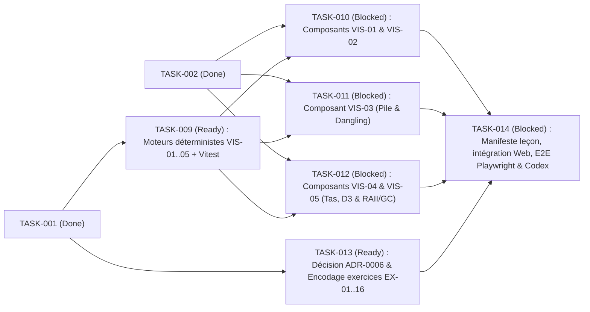

# Plan de développement atomique et Handoff Claude Code

Ce document transforme la conception complète du cours **« Comprendre le fonctionnement de la mémoire d'un programme »** en plan d'exécution atomique pour **Claude Code** (implémentation) et **Codex** (audit et validation).

---

## 1. Graphe de dépendances et parallélisme

### Pistes parallélisables immédiatement

- **Piste A (`TASK-009`, `Ready`)** : Moteurs d'états purs TypeScript + tests Vitest pour `VIS-01..VIS-05` dans `lessons/program-memory-fundamentals/engines/` (aucune dépendance UI bloquante).
- **Piste B (`TASK-013`, `Ready`)** : Valider avec l'utilisateur/architecte [ADR-0006](../../decisions/ADR-0006-interactive-diagram-probe-and-assessment-runner.md) (Option B `diagram-probe` + `AssessmentRunner`, ou Option A repli natif), puis encoder la banque `EX-01..EX-16` et `EVAL-01..EVAL-04` validée par Zod.
- **Vague 2 parallèle** (dès `TASK-009` terminée) : `TASK-010` (`VIS-01` + `VIS-02`), `TASK-011` (`VIS-03`) et `TASK-012` (`VIS-04` + `VIS-05`) peuvent être menées en parallèle car chaque simulateur est isolé dans `lessons/program-memory-fundamentals/components/`.

---

## 2. Inventaire des tâches atomiques

| ID         | Titre court                                                                                 | Itération  | Dépendances            | Statut    | Fiche tâche                                                                                  |
| ---------- | ------------------------------------------------------------------------------------------- | ---------- | ---------------------- | --------- | -------------------------------------------------------------------------------------------- |
| `TASK-009` | Moteurs déterministes TypeScript et tests Vitest (`VIS-01..05`)                             | `ITER-002` | `TASK-001`             | `Ready`   | [TASK-009](../../../planning/tasks/TASK-009-memory-course-state-engines.md)                  |
| `TASK-010` | Simulateurs interactifs `VIS-01` (CPU/RAM) et `VIS-02` (MMU/Segments)                       | `ITER-002` | `TASK-002`, `TASK-009` | `Blocked` | [TASK-010](../../../planning/tasks/TASK-010-memory-course-cpu-and-virtual-memory-visuals.md) |
| `TASK-011` | Simulateur interactif `VIS-03` (Pile d'appels, `RSP`/`RBP`, ABI & Dangling)                 | `ITER-002` | `TASK-002`, `TASK-009` | `Blocked` | [TASK-011](../../../planning/tasks/TASK-011-memory-course-call-stack-visual.md)              |
| `TASK-012` | Simulateurs interactifs `VIS-04` (Tas/Chunks/D3/UAF) et `VIS-05` (C vs Rust vs GC)          | `ITER-002` | `TASK-002`, `TASK-009` | `Blocked` | [TASK-012](../../../planning/tasks/TASK-012-memory-course-heap-and-models-visuals.md)        |
| `TASK-013` | Résolution `ADR-0006`, exercices `EX-01..16` & évaluation cumulative `EVAL-01..04`          | `ITER-002` | `TASK-001`             | `Ready`   | [TASK-013](../../../planning/tasks/TASK-013-memory-course-exercises-and-assessment.md)       |
| `TASK-014` | Assemblage `lessons/program-memory-fundamentals/lesson.json`, labos lecture seule, E2E & QA | `ITER-002` | `TASK-010`..`TASK-013` | `Blocked` | [TASK-014](../../../planning/tasks/TASK-014-memory-course-lesson-assembly-and-e2e.md)        |

---

## 3. Handoff structuré pour **Claude Code** (Implémentation)

### Contexte à charger en premier par Claude Code

1. Lire `CLAUDE.md`, `continuity/CURRENT_STATE.md`, `continuity/HANDOFF.md`.
2. Charger l'intégralité du dossier [docs/courses/program-memory-fundamentals/](.) (`00` à `07`).
3. Vérifier l'état de [ADR-0006](../../decisions/ADR-0006-interactive-diagram-probe-and-assessment-runner.md) : **demander confirmation humaine** si Option B (`diagram-probe` + `AssessmentRunner`) doit modifier `packages/lesson-runtime` et `packages/exercises`, sinon exécuter l'Option A documentée dans [05-BANQUE_EXERCICES.md](./05-BANQUE_EXERCICES.md).

### Règles impératives pendant l'implémentation

- **Environnement** : exécuter toutes les commandes Node/pnpm avec **Node LTS `22.x`** (`%LOCALAPPDATA%\Programs\nodejs-22`).
- **Isolation de leçon (`ADR-0003`)** : loger les moteurs et composants visuels dans `lessons/program-memory-fundamentals/` et enregistrer l'entrée de scène uniquement dans `apps/web/src/lib/lesson-scenes.tsx` (sans polluer `packages/ui` ni `packages/lesson-runtime` avec de la logique métier mémoire).
- **Animations (`@cyber-school/animations`)** : toujours passer par `createGsapTimelineScope` avec gestion native de `prefers-reduced-motion` et `cleanup` au démontage.
- **Zéro écriture de code apprenant** : aucune saisie syntaxique libre.
- **Ne pas marquer `published` prématurément** : créer `lessons/program-memory-fundamentals/lesson.json` en `publicationStatus: "draft"` puis `"in-review"`, conformément à [docs/standards/QUALITY_GATES.md](../../standards/QUALITY_GATES.md).

---

## 4. Protocole de validation finale pour **Codex**

Une fois `TASK-009`..`TASK-014` implémentées par Claude Code, Codex devra :

1. Vérifier que les 14 concepts de [curriculum/program-memory-foundations.json](../../../curriculum/program-memory-foundations.json) sont tous reliés à une section + un exercice actif dans `lessons/program-memory-fundamentals/lesson.json`.
2. Contrôler les critères scientifiques de [06-RIGUEUR_SCIENTIFIQUE_ET_SOURCES.md](./06-RIGUEUR_SCIENTIFIQUE_ET_SOURCES.md) et [07-CRITERES_ACCEPTATION.md](./07-CRITERES_ACCEPTATION.md) (little-endian sans inversion intra-octet, pile décroissante avec résidus visibles, `tcache`/fragmentation, encarts `-O2`/ASLR/UB).
3. Exécuter la chaîne complète et vérifier les preuves :
   `typecheck`, `lint`, `format:check`, `validate:curriculum`, `test:unit`, `test:guards`, `build`, `test:e2e`, `quality:verify --task TASK-014`, `validate:governance`.
4. Auditer les scénarios Playwright (`reduced-motion`, navigation clavier seule, viewport `375px`, zéro erreur console) via le skill `.agents/skills/browser-validation/SKILL.md`.
